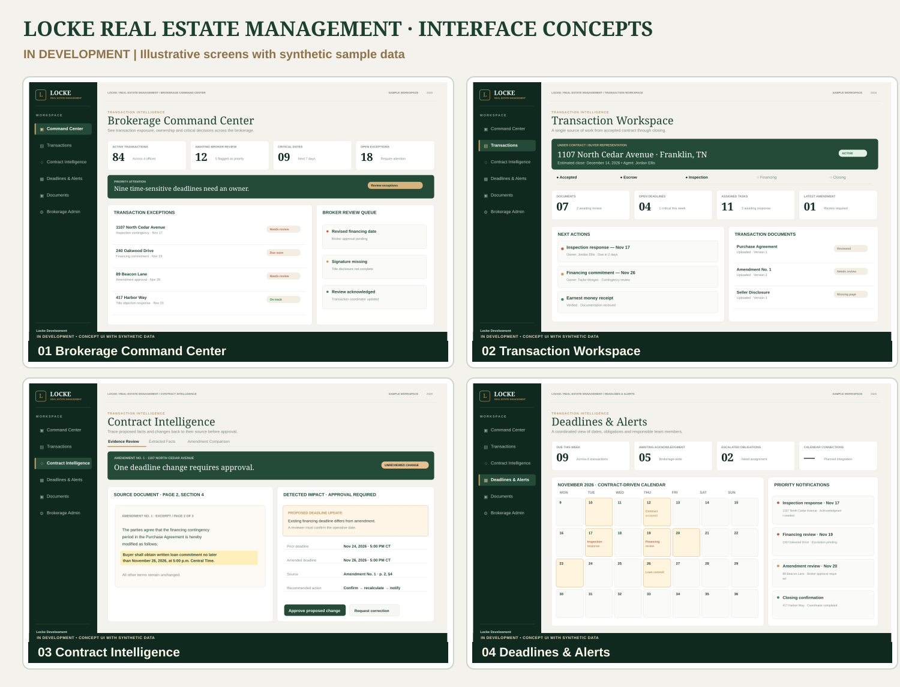
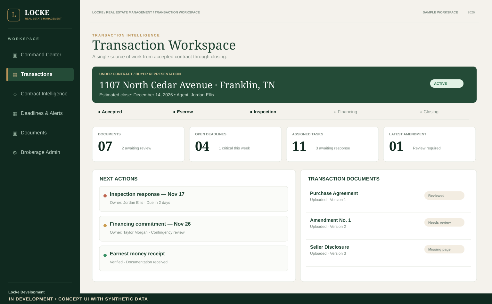
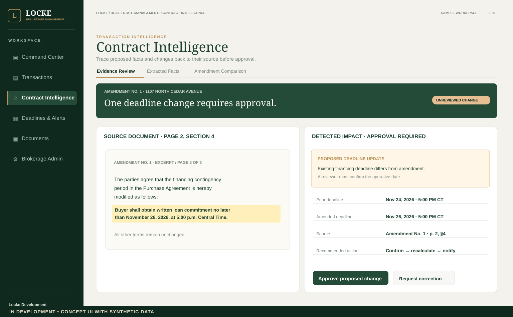

# LOCKE REAL ESTATE MANAGEMENT
### From contract language to closing confidence.

**IN DEVELOPMENT** · A Locke Development product engineering portfolio

**Contract intelligence · Critical dates · Transaction execution · Brokerage oversight**

[**Explore the brochure**](BROCHURE.md) · [**See sample UI screens**](SCREENS.md) · [**Product capabilities**](CAPABILITIES.md) · [**Visual brochure**](index.html)

---

## The transaction is more than a checklist.

A purchase contract determines who must act, what must happen, and when. Amendments can change those obligations while multiple agents, coordinators, brokers, lenders and closing professionals work against different records.

**Locke Real Estate Management is being developed to connect the signed document to the work that follows:** identify key terms, trace them to their source, route consequential findings through human review, and make contractual obligations visible across the transaction and brokerage.

### A preview of the workspace

*Concept interface using entirely synthetic sample information; not a live application capture.*

| Transaction workspace | Evidence-based contract review |
|:--:|:--:|
|  |  |

**[View all four sample screens](SCREENS.md)** — including deadlines and alerts.

---

## Designed for contract-to-close operations

| Capability | Intended product value |
|---|---|
| **Contract intelligence** | Extract proposed dates, parties, obligations, contingencies and material provisions from transaction documents, with traceable source evidence. |
| **Deadline command** | Calculate, assign and monitor contract-specific dates, reminder windows, approvals and escalation responsibilities. |
| **Amendment impact** | Compare successive documents and preview how a revised clause changes dates, tasks and alerts before updates are approved. |
| **Brokerage command center** | Surface unreviewed changes, critical exceptions, missing documents and ownership gaps across offices. |
| **Ask the contract** | Explore authorized transaction records with evidence-linked answers and clear handling of missing support. |
| **Team coordination** | Connect agents, managing brokers, coordinators and administrators through role-based queues and review history. |
| **Works with existing tools** | Planned calendar, notification, document-intake and e-sign status integrations, without replacing a brokerage's CRM. |

## Nationwide by design

The intended product supports transaction records across **all 50 U.S. states and Washington, DC**, with jurisdiction-aware language, time rules and coverage tracking. **Jurisdiction selection does not imply that every state's forms or legal rules have been independently validated**; state-specific analysis is gated by verified sources and coverage status.

## Product direction

**Contract uploaded → facts proposed with evidence → broker/team review → approved dates and obligations → work assignments and alerts → amendment reconciliation → closing readiness.**

This public repository is a **brochure and design-preview portfolio**, not the application source repository. Screens show the proposed experience and use synthetic illustrative data; capabilities are in development and may change before release.

---

[**Read the brochure**](BROCHURE.md) · [**Explore the screens**](SCREENS.md) · [**Visit Locke Development**](https://lockedevelopment.com/)

© 2026 Locke Development · Product in development · Concept visuals, not production screenshots.