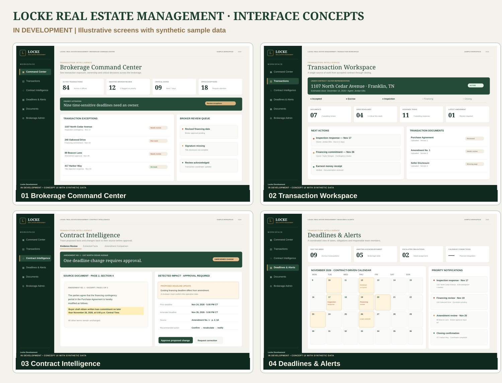
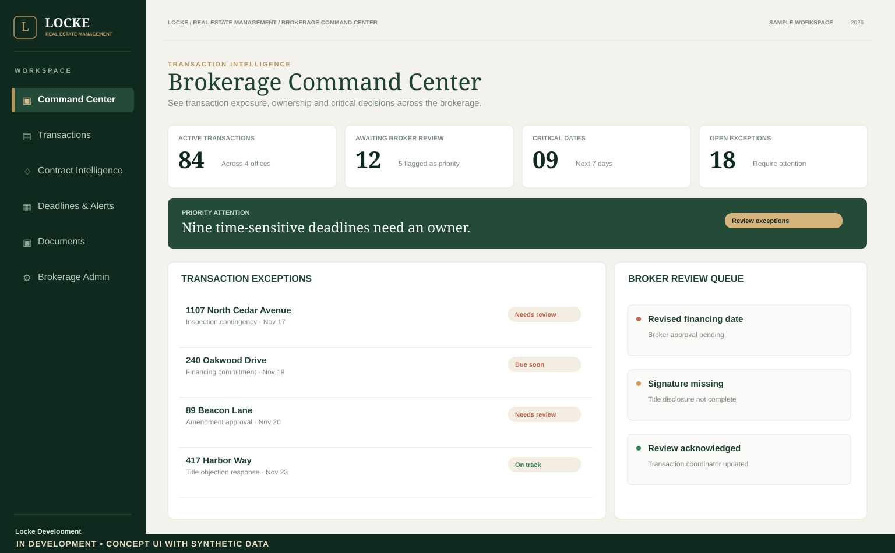
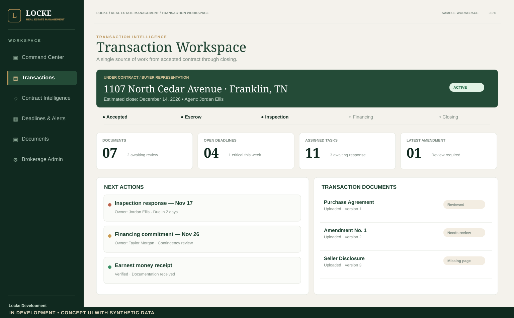
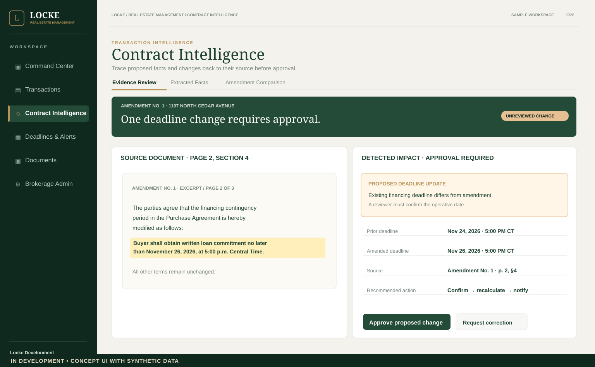
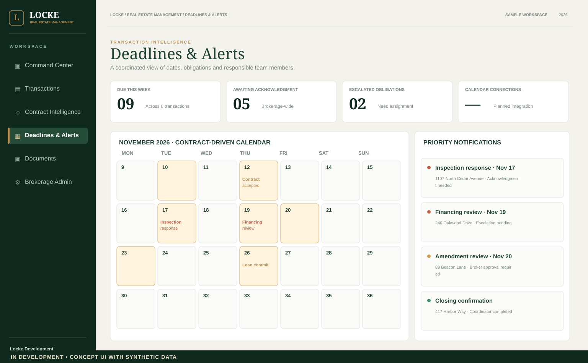

# Sample interface gallery

**Status:** In development · **Media type:** Illustrative UI concepts · **Data:** Fully synthetic examples

These visuals follow the existing product's forest-green, cream and gold design direction while demonstrating the target user experience; they are **not** screenshots from a running authenticated production application.

## 1. Brokerage Command Center

Brokerage-wide operational view with review queues, upcoming critical dates and exceptions assigned to responsible personnel.

## 2. Transaction Workspace

A single transaction record for contract milestones, documents, assigned tasks and deadline ownership.

## 3. Contract Intelligence

Review proposed amendment impacts with highlighted source text and explicit human approval before consequential changes.

## 4. Deadlines and Alerts

A contract-driven calendar with priority reminders, assigned responsibilities and acknowledgment states.

*Dates, transactions, personnel, contracts and dashboard totals are invented solely for product illustration.*